# Proje 01: Lab Ortamı Kurulumu (Windows 10 İstemci)

Bu proje, IT helpdesk lab ortamımın ilk adımıdır. VMware Workstation üzerinde bir Windows 10 istemci makinesi kurdum, yapılandırdım ve geri dönülebilir temiz bir başlangıç noktası (snapshot) oluşturdum. Sonraki projelerde bu ortama Windows Server ve Active Directory eklenecek.

## Hedefler

- VMware Workstation'da sanal makine oluşturmak
- Windows 10 Pro'yu sıfırdan kurmak
- VMware Tools ile sanal makine entegrasyonunu tamamlamak
- Ağ yapılandırmasını `ipconfig /all` ile doğrulamak
- Snapshot ile geri dönüş noktası oluşturmak

## Kullanılan araçlar

| Araç | Detay |
|------|-------|
| Sanallaştırma | VMware Workstation |
| İşletim sistemi | Windows 10 Pro (x64) |
| Ağ modu | NAT |
| Komut satırı | `ipconfig /all` |

## Sanal makine özellikleri

| Özellik | Değer |
|---------|-------|
| RAM | 2 GB |
| İşlemci | 2 |
| Disk | 50 GB (NVMe) |
| Ağ adaptörü | NAT |
| Donanım uyumluluğu | Workstation 25H2 veya üzeri |

## Adımlar

### 1. Sanal makineyi oluşturma

VMware'de yeni bir sanal makine oluşturdum. RAM miktarını, VMware'in önerdiği ve işletim sisteminin minimum değeri olan 2 GB olarak bıraktım. Ağ adaptörü NAT: sanal makine ana bilgisayarın internet bağlantısını kullanır, ama ana bilgisayarın yerel ağından ayrı kalır.

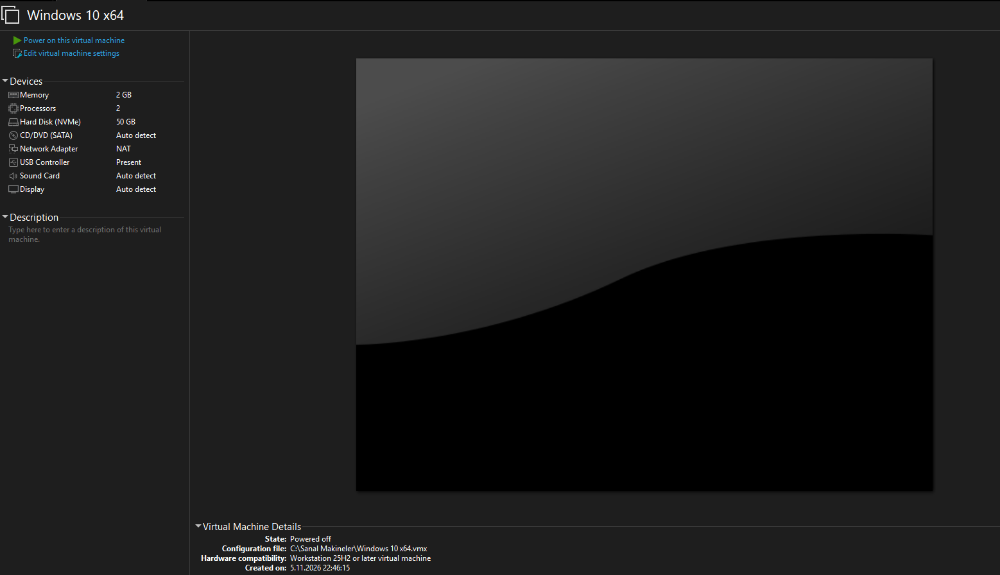
*Sanal makinenin özet ekranı: 2 GB RAM, 2 işlemci, 50 GB disk, NAT ağ.*

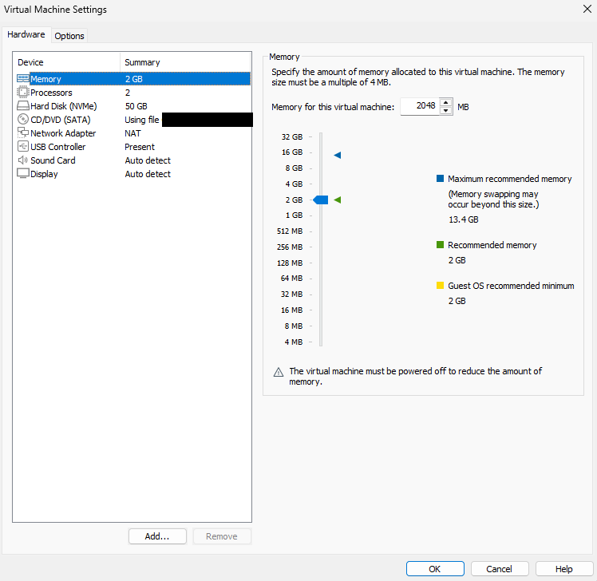
*Bellek ayarları: önerilen ve minimum değer 2 GB.*

### 2. Windows 10 kurulumu

Kurulum ekranında Windows 10 Pro sürümünü seçtim. Disk ekranında 50 GB'lık ayrılmamış alan göründü ve Windows'u bu alana kurdum.

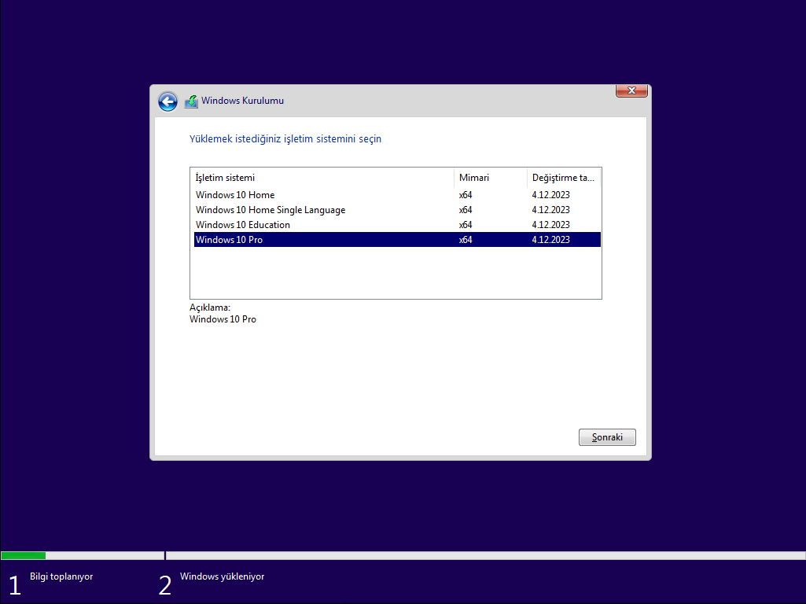
*İşletim sistemi sürümü: Windows 10 Pro.*

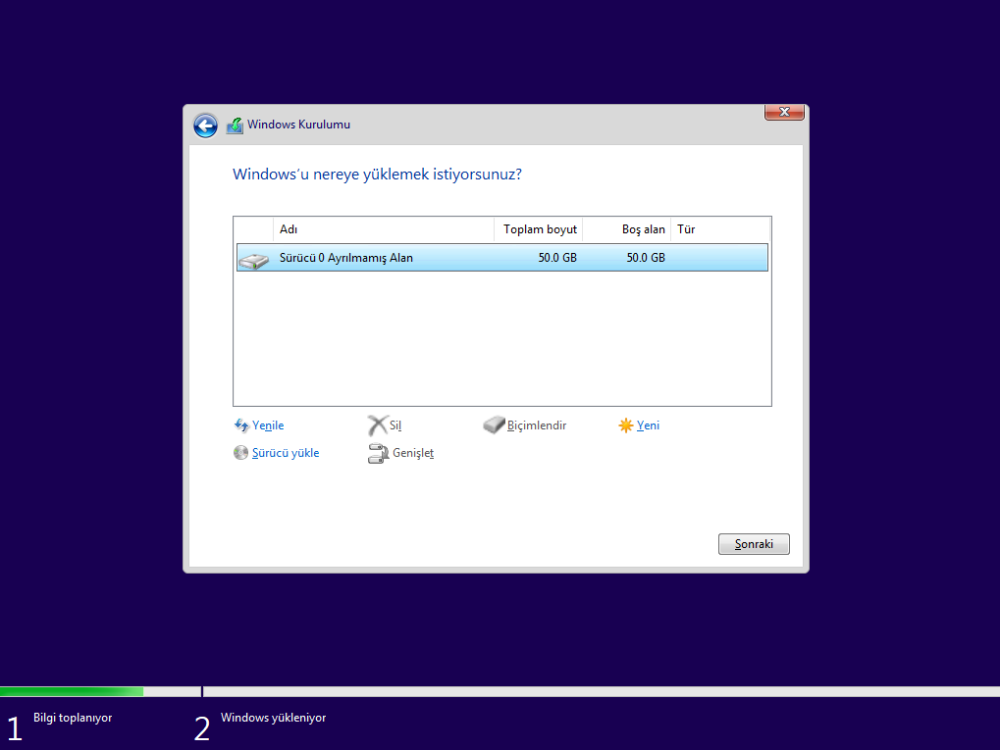
*Windows'un kurulacağı 50 GB'lık ayrılmamış alan.*

### 3. İlk açılış

Kurulum bittikten sonra yerel bir kullanıcı hesabıyla (`CLIENT01`) oturum açtım. Kişisel bir hesap yerine nötr bir ad kullandım, böylece lab ortamı gerçek kimlik bilgilerimden ayrı kaldı.

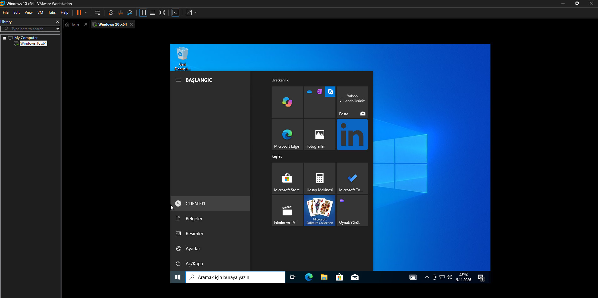
*İlk oturum: Başlat menüsünde yerel hesap `CLIENT01`.*

### 4. VMware Tools kurulumu

VMware Tools; ekran çözünürlüğü, fare ve pano entegrasyonu gibi sanal makine ile ana bilgisayar arasındaki iletişimi sağlayan sürücüleri kurar. *VM → Install VMware Tools* ile sanal CD'yi bağladım, kurulumu D: sürücüsünden çalıştırdım. Kurulum sonunda sistem yeniden başlatma istedi.

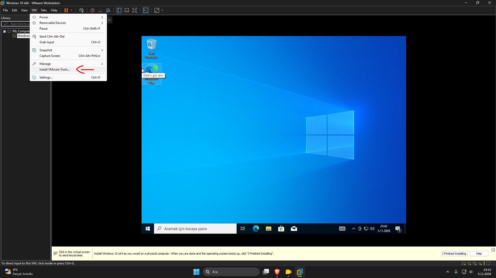
*VM menüsünden VMware Tools kurulumunu başlatma.*

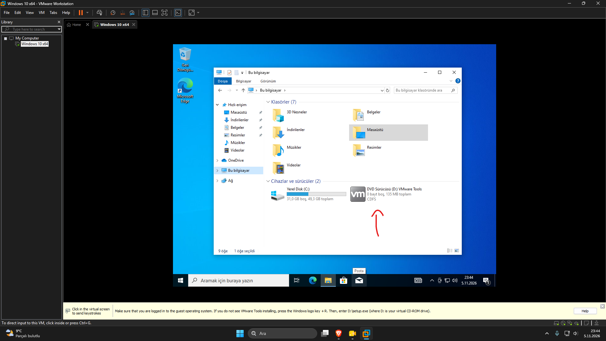
*Sanal CD sürücüsü (D:) olarak bağlanan VMware Tools.*

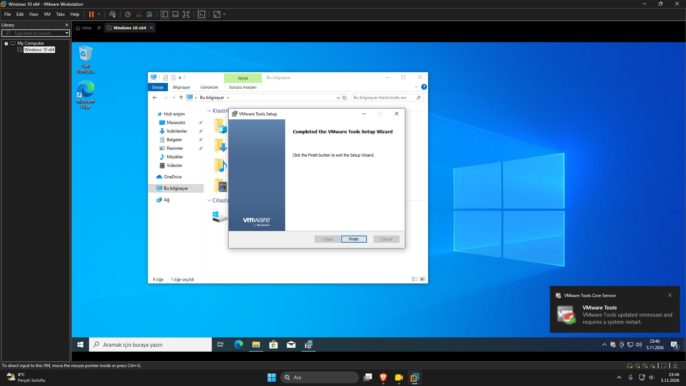
*Kurulum sihirbazı tamamlandı; yeniden başlatma uyarısı.*

### 5. Aygıt Yöneticisi kontrolü

Kurulumdan sonra Aygıt Yöneticisi'ni açıp sürücü durumuna baktım. Bilinmeyen aygıt ya da uyarı işareti görünmüyor.

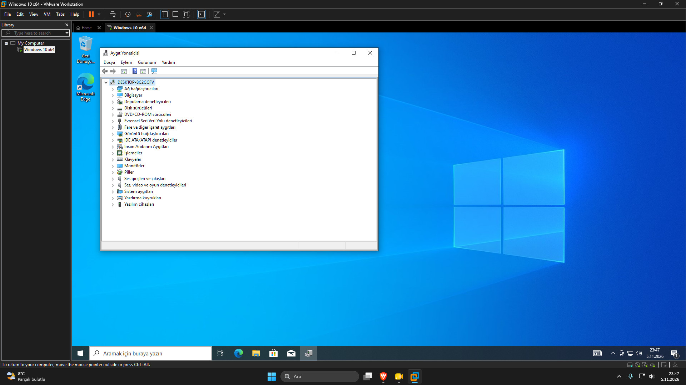
*Aygıt Yöneticisi: eksik sürücü kategorisi yok. Bilgisayar adı bu aşamada hâlâ Windows'un verdiği varsayılan ad.*

### 6. Ağ yapılandırmasını doğrulama

`ipconfig /all` komutuyla sanal makinenin ağ bilgilerini kontrol ettim. IP adresi VMware'in NAT ağından DHCP ile geliyor.

| Alan | Değer |
|------|-------|
| IPv4 adresi | 192.168.204.129 |
| Alt ağ maskesi | 255.255.255.0 |
| Varsayılan ağ geçidi | 192.168.204.2 |
| DHCP sunucusu | 192.168.204.254 |
| DNS sunucusu | 192.168.204.2 |
| DHCP | Etkin |

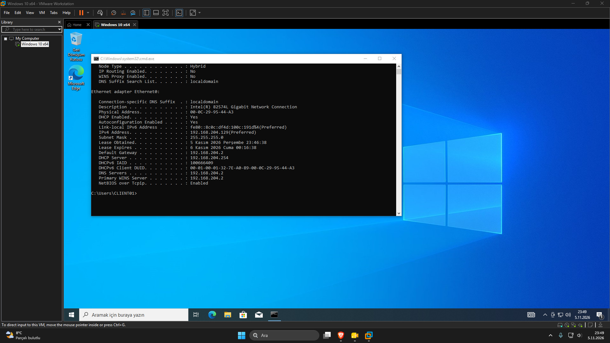
*`ipconfig /all` çıktısı.*

### 7. Snapshot oluşturma

Sistemi temiz haliyle kaydetmek için `Temiz Kurulum` adında bir snapshot aldım. İleride yapılandırmayı bozarsam ya da sorun senaryoları denersem tek tıkla bu noktaya dönebileceğim.

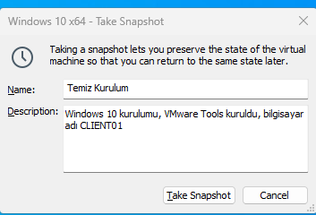
*Snapshot adı ve açıklaması.*

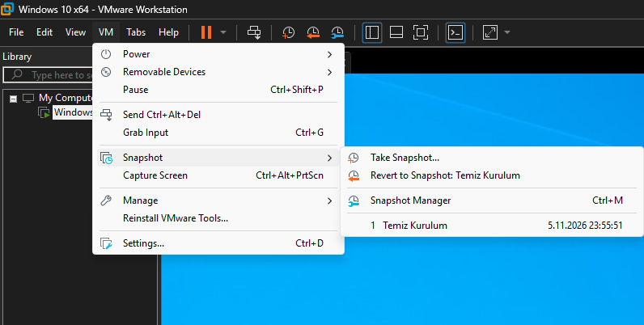
*Snapshot oluştu; "Revert to Snapshot" seçeneği artık menüde.*

### 8. Bilgisayar adını değiştirme

Windows kurulumunda bilgisayara rastgele bir ad verilmişti (`DESKTOP-8C2CCFV`). Active Directory'ye geçmeden önce lab makinelerini anlamlı adlandırmak için adı `CLIENT01` olarak değiştirdim. *Ayarlar → Sistem → Hakkında → Bu bilgisayarı yeniden adlandır* yolunu izledim ve sistemi yeniden başlattım.

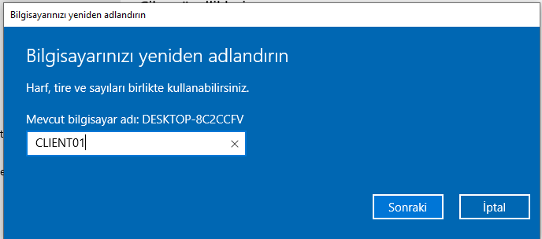
*Mevcut ad `DESKTOP-8C2CCFV`, yeni ad `CLIENT01`.*

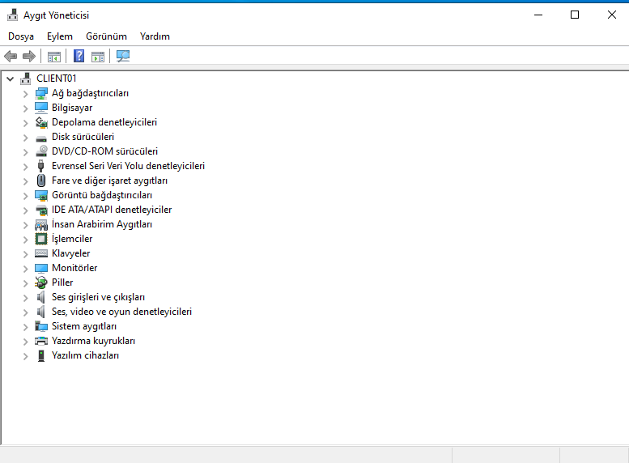
*Yeniden başlatmadan sonra Aygıt Yöneticisi'nde bilgisayar adı `CLIENT01` olarak görünüyor.*

## Öğrendiklerim

- Sanal makine için kaynak planlaması: RAM, işlemci ve disk boyutu önerilen değerlere göre seçilir.
- NAT ağ modunda sanal makine internete çıkar ama ana bilgisayarın yerel ağından ayrı kalır.
- VMware Tools kurulumu olmadan sanal makine tam verimli çalışmaz.
- Snapshot, denemeler yapmadan önce güvenli bir geri dönüş noktası sağlar.
- Bilgisayar adı ile kullanıcı adı farklı şeylerdir: kullanıcı adı `CLIENT01` iken bilgisayar adı ayrıca değiştirilmesi gereken bir ayardı.

## Sonraki adım

Proje 02: Windows Server kurulumu ve Active Directory etki alanı oluşturma.
