# Proje 02: Windows Server 2022 Kurulumu ve Ağ Yapılandırması (DC01)

Bu projede lab ortamıma ikinci makineyi ekledim: VMware Workstation üzerinde Windows Server 2022 kurdum, `DC01` adını verdim, sabit IP atadım ve Proje 01'deki `CLIENT01` ile aralarındaki bağlantıyı doğruladım. Süreçte iki ağ sorunuyla karşılaştım ve çözdüm (aşağıda "Karşılaştığım sorunlar" bölümünde). Sonraki projede bu sunucuya Active Directory kurulacak.

## Hedefler

- Windows Server 2022'yi VMware'de sıfırdan kurmak
- VMware Tools kurmak, bilgisayara anlamlı bir ad vermek
- Sunucuya sabit IP atamak
- İstemci ile sunucu arasındaki ağ bağlantısını test etmek ve sorunları gidermek
- Geri dönüş noktası (snapshot) oluşturmak

## Kullanılan araçlar

| Araç | Detay |
|------|-------|
| Sanallaştırma | VMware Workstation |
| Sunucu işletim sistemi | Windows Server 2022 Datacenter Evaluation (Desktop Experience) |
| İstemci | Windows 10 Pro (`CLIENT01`, Proje 01) |
| Ağ modu | NAT (iki makine de aynı sanal ağda) |
| Araçlar | `ipconfig`, `ping`, PowerShell |

## Sanal makine özellikleri (DC01)

| Özellik | Değer |
|---------|-------|
| RAM | 4 GB |
| İşlemci | 2 |
| Disk | 60 GB (NVMe) |
| Ağ adaptörü | NAT |

## Ağ planı

| Makine | Ad | IP adresi |
|--------|----|-----------|
| Sunucu | `DC01` | 192.168.204.10 (sabit) |
| İstemci | `CLIENT01` | 192.168.204.129 (DHCP) |
| Ağ geçidi ve DNS | VMware NAT | 192.168.204.2 |

## Adımlar

### 1. Sanal makine ayarları

Sunucu için 4 GB RAM, 2 işlemci ve 60 GB disk ayırdım. Ağ adaptörünü istemciyle aynı şekilde NAT yaptım, böylece iki makine aynı sanal ağda.

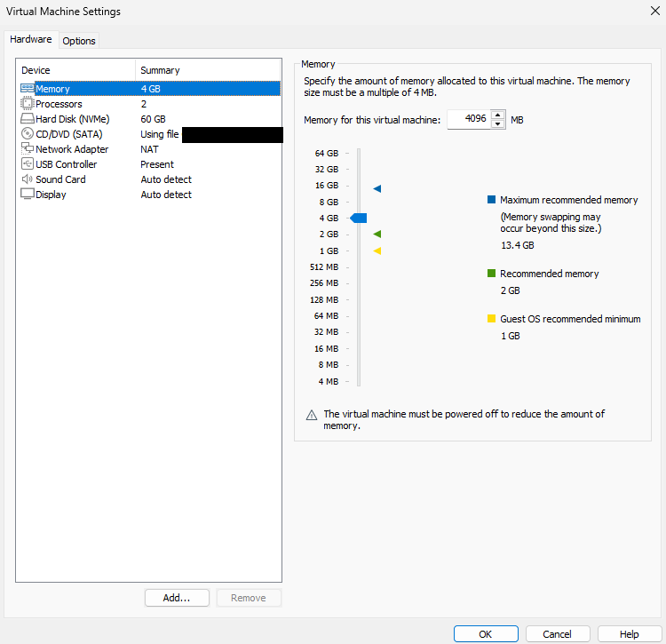
*DC01 donanım ayarları: 4 GB RAM, 2 işlemci, 60 GB disk, NAT ağ.*

### 2. Windows Server kurulumu

Kurulum dilini İngilizce, klavyeyi Türkçe Q seçtim. Sürüm olarak **Windows Server 2022 Datacenter Evaluation (Desktop Experience)** seçtim. Desktop Experience, grafik arayüzlü sürümdür. Disk ekranında 60 GB'lık ayrılmamış alan göründü ve sunucuyu bu alana kurdum.

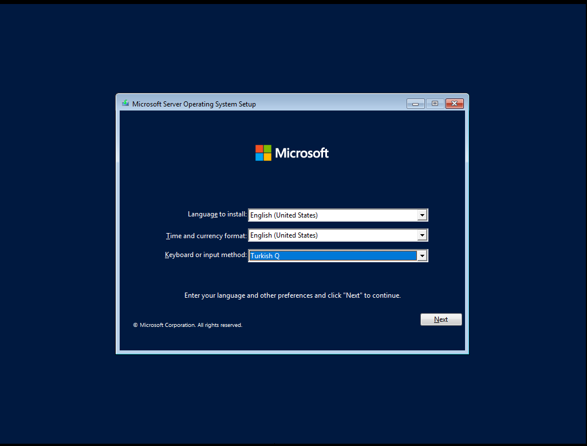
*Kurulum dili İngilizce, klavye Türkçe Q.*

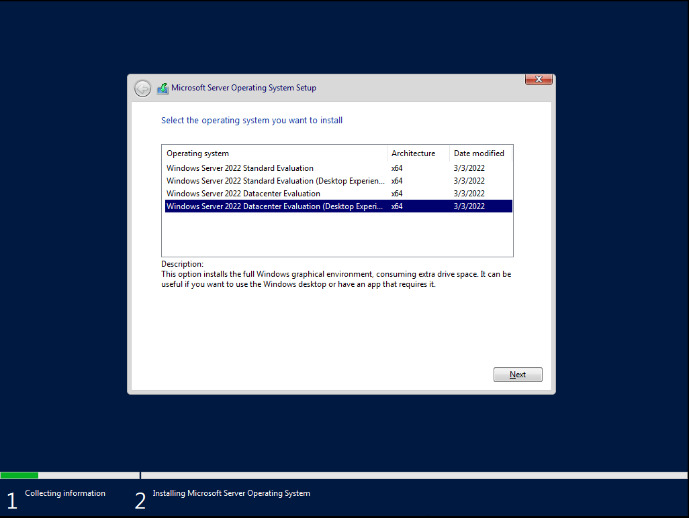
*Sürüm seçimi: Datacenter Evaluation (Desktop Experience).*

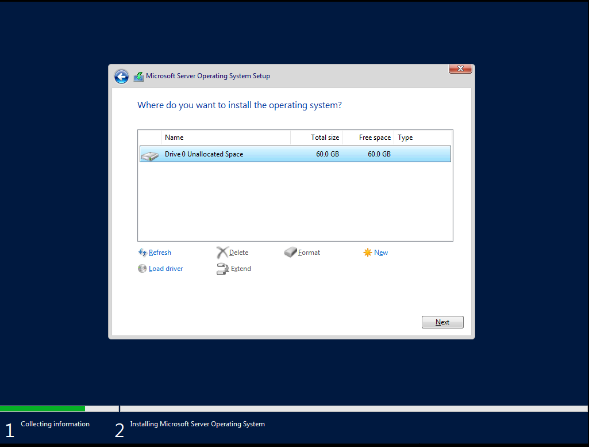
*Sunucunun kurulacağı 60 GB'lık ayrılmamış alan.*

### 3. İlk giriş

Kurulumdan sonra `Administrator` hesabıyla giriş yaptım. Oturum açılınca Server Manager kendiliğinden açıldı. Sunucunun rollerini ve özelliklerini buradan yöneteceğiz.

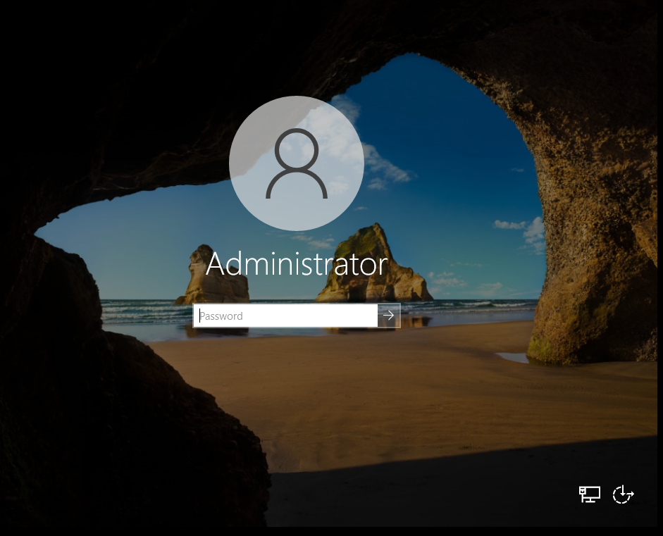
*Administrator hesabı giriş ekranı.*

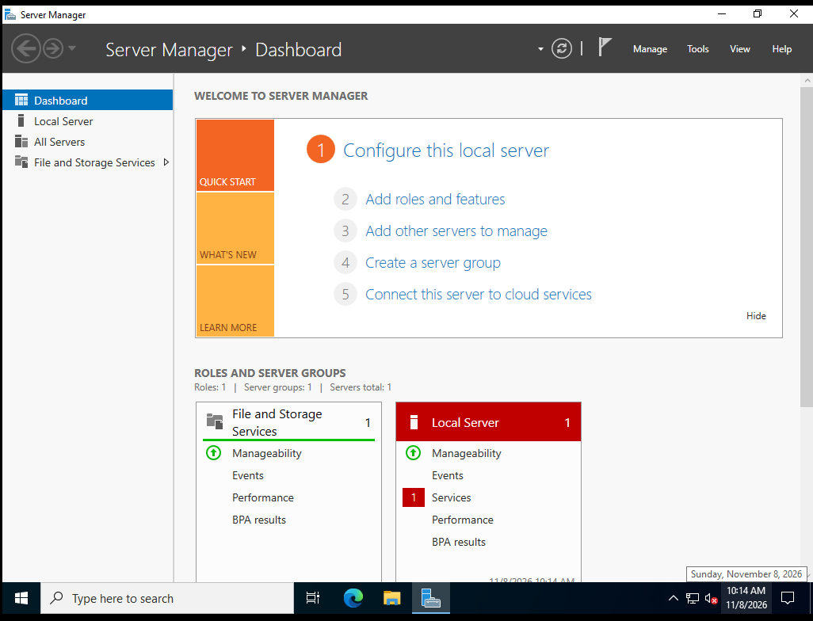
*Server Manager panosu.*

### 4. VMware Tools kurulumu

*VM → Install VMware Tools* ile sanal CD'yi bağlayıp kurulumu D: sürücüsünden çalıştırdım. VMware Tools; ekran, fare ve pano entegrasyonunu sağlar. Kurulumdan sonra sistemi yeniden başlattım.

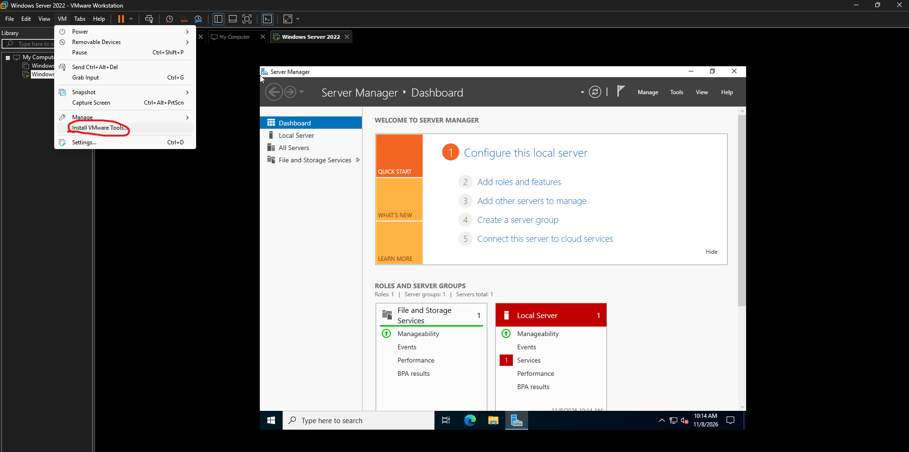
*VM menüsünden VMware Tools kurulumunu başlatma.*

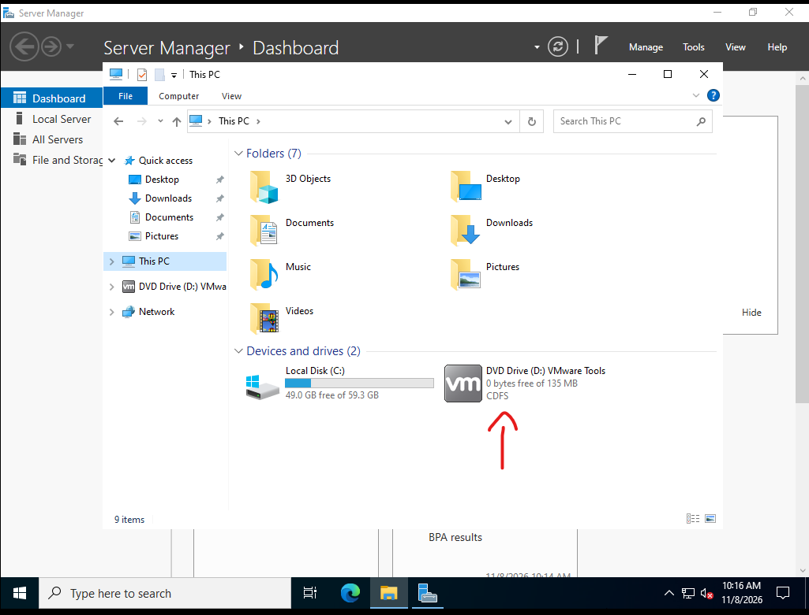
*Sanal CD sürücüsü (D:) olarak bağlanan VMware Tools. C: sürücüsünde 59,3 GB'ın 49 GB'ı boş.*

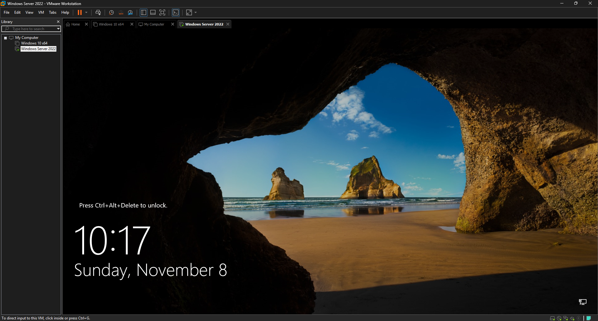
*Yeniden başlatmadan sonra kilit ekranı.*

### 5. Bilgisayar adını değiştirme

Kurulumda sunucuya rastgele bir ad verilmişti (`WIN-7LE391HHO81`). *Ayarlar → Sistem → Hakkında → Rename this PC* ile adı `DC01` yaptım ve yeniden başlattım. DC, "domain controller" (etki alanı denetleyicisi) anlamına gelir ve bir sonraki projede bu sunucu o rolü üstlenecek.

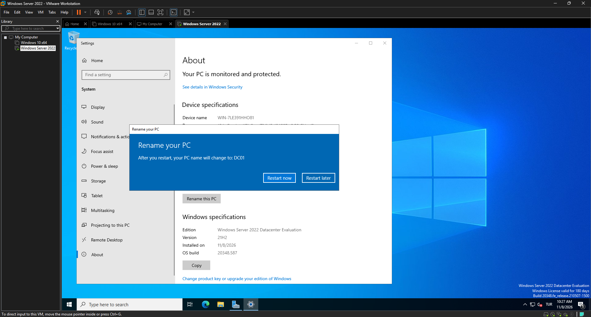
*Yeniden başlatmadan sonra bilgisayar adı DC01 olacak.*

### 6. Sabit IP atama

Domain controller'ın IP adresi değişmemeli, bu yüzden DHCP yerine sabit IP verdim. IP adresi olarak NAT ağında DHCP aralığının dışında kalan `192.168.204.10` adresini seçtim.

Ağ geçidi ve DNS alanlarını ilk denemede boş bırakmıştım, bu da bir sorun çıkardı (bkz. "Karşılaştığım sorunlar", Sorun 1). Düzeltilmiş hali:

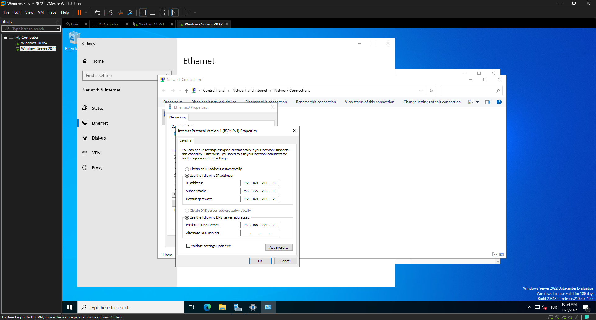
*IP: 192.168.204.10, maske: 255.255.255.0, ağ geçidi ve DNS: 192.168.204.2.*

`ipconfig` ile ayarların uygulandığını doğruladım:

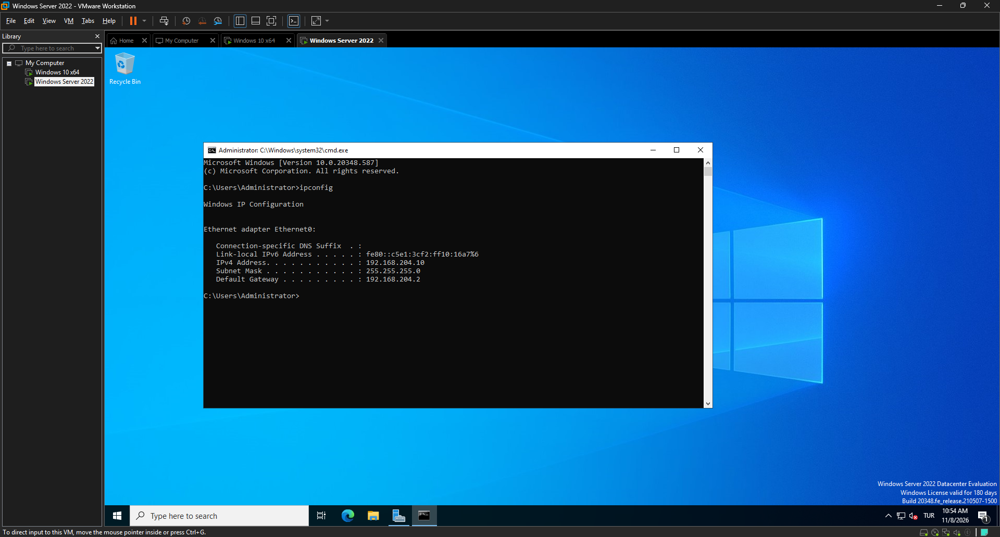
*DC01'de `ipconfig` çıktısı: IPv4 192.168.204.10, ağ geçidi 192.168.204.2.*

### 7. Snapshot oluşturma

Bağlantıyı doğruladıktan sonra sunucunun çalışır halini `DC01-Hazir` adıyla kaydettim. Active Directory kurulumunda bir sorun çıkarsa bu noktaya dönebileceğim.

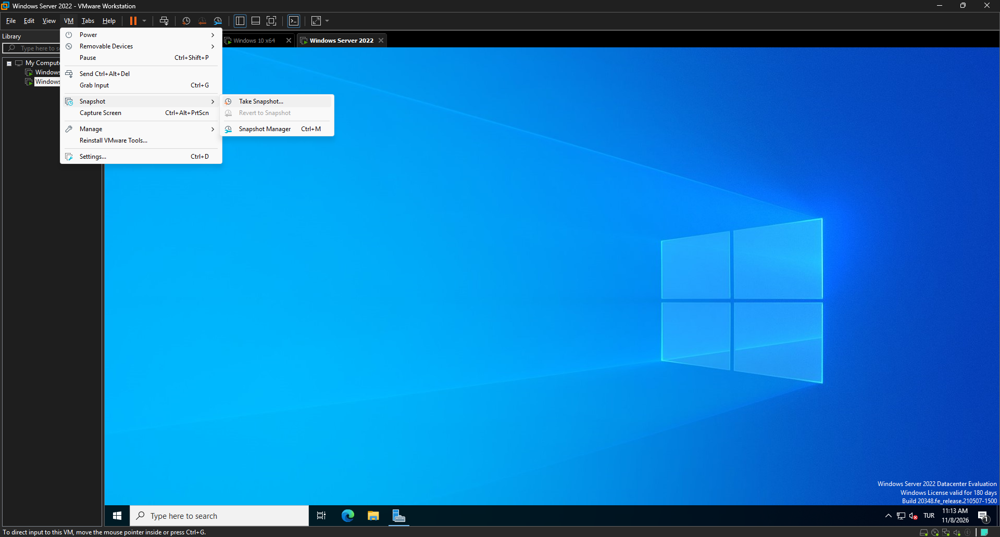
*VM → Snapshot menüsü.*

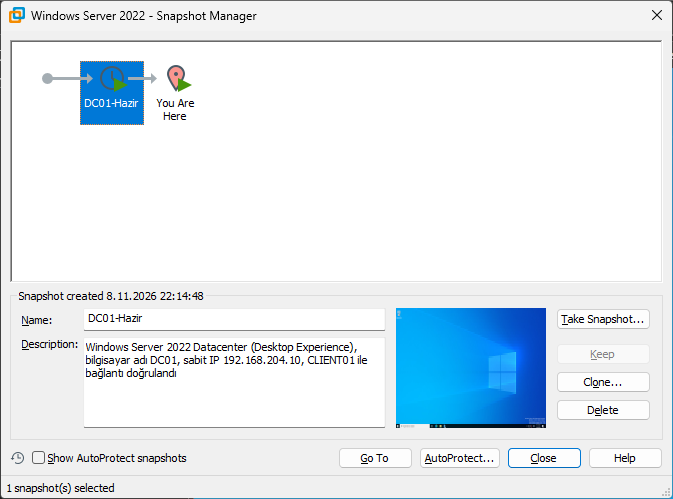
*`DC01-Hazir` snapshot'ı ve açıklaması.*

## Karşılaştığım sorunlar ve çözümler

### Sorun 1: "Unidentified network" uyarısı

**Belirti:** Sabit IP verdikten sonra Windows ağı "Unidentified network" olarak gösterdi.

**Sebep:** IP adresi ve alt ağ maskesini girmiştim ama **varsayılan ağ geçidi (Default gateway)** ve **tercih edilen DNS sunucusu (Preferred DNS server)** alanlarını boş bırakmıştım. Ağ geçidi olmayan bir yapılandırmada Windows ağı tanıyamıyor.

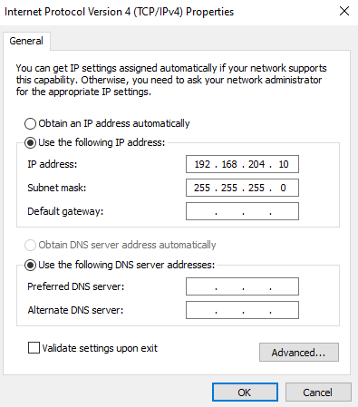
*Sorunlu yapılandırma: ağ geçidi ve DNS boş.*

**Çözüm:** İkisine de VMware NAT ağının geçidi olan `192.168.204.2` adresini girdim (bkz. adım 6'daki düzeltilmiş ayar).

### Sorun 2: İstemciden sunucuya ping atılamıyor

**Belirti:** `CLIENT01`'den `ping 192.168.204.10` komutu dört denemede de `Request timed out` verdi, %100 paket kaybı.


*İlk deneme: istek zaman aşımına uğradı.*

**Sebep:** Ağ ayarları doğruydu. Sorun Windows Server'ın güvenlik duvarındaydı: sunucu, varsayılan olarak dışarıdan gelen ping isteklerini (ICMPv4 Echo Request) engelliyor, bu yüzden cevap dönmüyordu.

**Çözüm:** DC01'de PowerShell'i yönetici olarak açıp bu isteğe izin veren hazır güvenlik duvarı kuralını etkinleştirdim:

```powershell
Enable-NetFirewallRule -DisplayName "File and Printer Sharing (Echo Request - ICMPv4-In)"
```

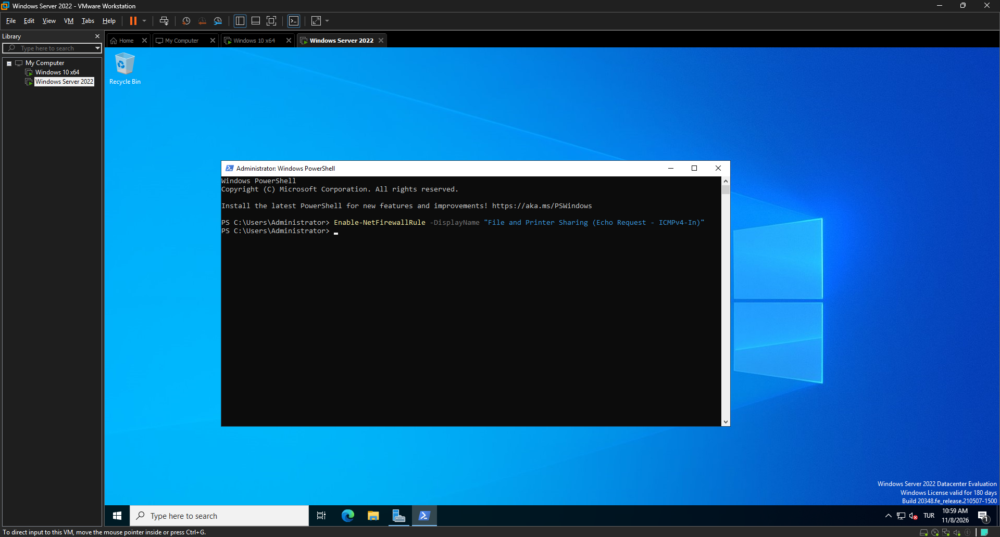
*PowerShell'de kuralı etkinleştirme komutu.*

Komut yalnızca ping'e izin verir, başka bir port ya da hizmet açmaz. İstenirse kural şu komutla tekrar kapatılabilir:

```powershell
Disable-NetFirewallRule -DisplayName "File and Printer Sharing (Echo Request - ICMPv4-In)"
```

Kuralı açtıktan sonra aynı komutu tekrar çalıştırdığımda dört cevap da geldi, %0 kayıp:

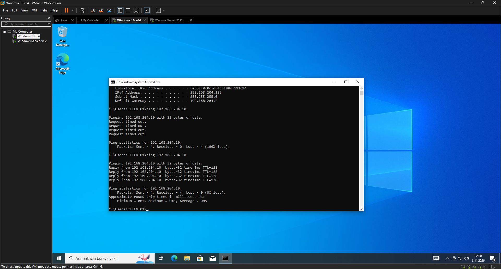
*Aynı pencerede önce başarısız, ardından kural açıldıktan sonra başarılı ping.*

## Öğrendiklerim

- Sabit IP verirken IP ve maskenin yanında varsayılan ağ geçidi ile DNS de girilmeli, yoksa Windows ağı tanımaz.
- Ağ bağlantısı doğru olsa bile güvenlik duvarı ping'i engelleyebilir. "Request timed out", her zaman ağ sorunu demek değildir.
- Bir sorunu aşamalı daraltmak işe yarar: önce IP ayarı (`ipconfig`), sonra bağlantı testi (`ping`), sonra güvenlik duvarı.
- Windows Server'da hazır güvenlik duvarı kuralları PowerShell ile tek komutta açılıp kapatılabilir.
- Snapshot'ı, bir şey kurmadan önce çalışan ve doğrulanmış haliyle almak güvenli bir geri dönüş noktası sağlar.

## Sonraki adım

Proje 03: `DC01`'e Active Directory Domain Services rolünü kurmak, etki alanı oluşturmak ve `CLIENT01`'i bu etki alanına katmak.
